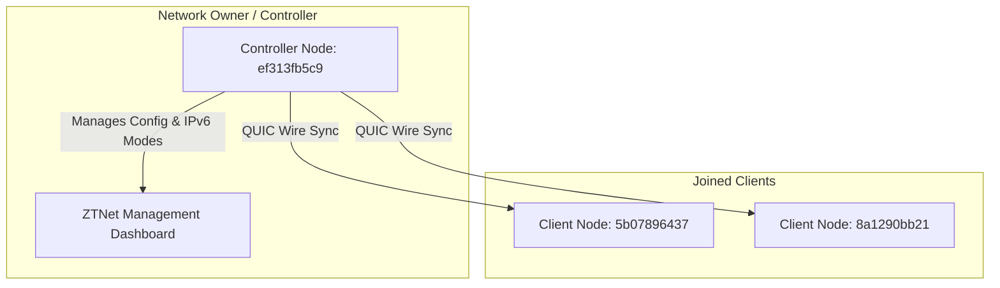

# Operating Modes & Role-Based Authority Model

This document outlines the architecture, operating modes, and role-based authority models of **ZGALAXY-RS**.

---

## 1. Operating Modes Architecture

Every `zgalaxy-rs` node contains both **Client Engine** capabilities and **Embedded Controller Engine** capabilities. However, to guarantee security, avoid rogue network announcements, and ensure a lightweight desktop footprint, `zgalaxy-rs` strictly separates operating modes.

```
┌─────────────────────────────────────────────────────────────┐
│                       zgalaxy-rs Node                       │
├──────────────────────────────┬──────────────────────────────┤
│    Client Mode (Default)     │   Controller Mode (Explicit) │
├──────────────────────────────┼──────────────────────────────┤
│ • Desktop GUI (zgalaxy-ui)   │ • ZTNet Server Deployment    │
│ • Zero Controller API routes │ • FileDB (controller.d/)     │
│ • Automatic Startup          │ • Pool & IP Allocation       │
│ • QUIC Peer Join & Sync      │ • QUIC Config Serving        │
└──────────────────────────────┴──────────────────────────────┘
```

### A. Client Mode (Standard Default)
- **Default for all desktop and standard client installations.**
- Starts immediately in Client Mode without any extra configuration.
- **Desktop UI (`zgalaxy-ui`)**: Designed exclusively for Client Mode. Contains no controller options or network creation toggles.
- **Security Guarding**:
  - `GET /controller` returns `{"controller": false, "apiVersion": 0}`.
  - All `/controller/network...` REST API routes return `403 Forbidden`.
  - Inbound peer `NetworkConfigRequest` requests over QUIC are rejected.

### B. Controller Mode (Explicit Activation Only)
- **Optional mode designed exclusively for server / ZTNet controller nodes.**
- Must be explicitly activated using one of the following methods:
  1. **CLI Flag**: `zgalaxy-rs --controller` or `-C` or `--mode=controller`
  2. **Installer Flag**: `sudo bash install.sh --controller`
  3. **Configuration File (`local.conf`)**:
     ```json
     {
       "settings": {
         "controller": true,
         "allowManagementFrom": ["127.0.0.1", "::1", "172.16.0.0/12"]
       }
     }
     ```
  4. **Environment Variables**: `ZGALAXY_CONTROLLER=1` or `ZGALAXY_MODE=controller`
- **Capabilities**:
  - Initializes `EmbeddedController` database under `/var/lib/zerotier-one/controller.d/`.
  - Full REST API active on port `9993` for **ZTNet** management.
  - Serves signed network configuration and membership tokens over QUIC.

---

## 2. Role-Based Authority Model

When interacting with networks, a node's capabilities are determined by its **Role** relative to the Network ID:

$$\text{Network ID (16 hex chars)} = \text{Controller Address (10 hex)} + \text{Network Index (6 hex)}$$



### 1. Network Owner (`Network Owner / Controller`)
- Condition: `network_id[..10] == node_address`
- Authority:
  - Defines network IP pools (IPv4, IPv6 6PLANE, RFC4193, Custom RFC 7217 ranges).
  - Authorizes / de-authorizes members.
  - Configures routes, MTU, and DNS settings.
  - Issues cryptographic membership tokens.

### 2. Joined Member (`Joined Member / Client Mode`)
- Condition: `network_id[..10] != node_address`
- Authority:
  - Connects to the network and sends authenticated join requests.
  - Applies authoritative configuration served by the Controller.
  - Cannot dictate or fabricate network configuration or address assignments.
  - Dynamic UI indicators reflect `Joined Member (Client Mode)`.

---

## 3. Real-Time Dynamic Synchronization

When a Network Owner updates network settings via ZTNet (such as enabling/disabling 6PLANE IPv6 or adding routes):
1. **Controller**: Prunes or generates member IP assignments and increments the network `revision`.
2. **QUIC Wire Engine**: Delivers the updated signed `NetworkConfigResponse` to all connected clients in real time.
3. **Client TAP Interface (`zgalaxy0`)**: Dynamically reconciles interface IP addresses and kernel routes with zero packet drops and zero reconnections.
4. **Desktop UI (`zgalaxy-ui`)**: Instantly updates displayed cards and status emojis.
